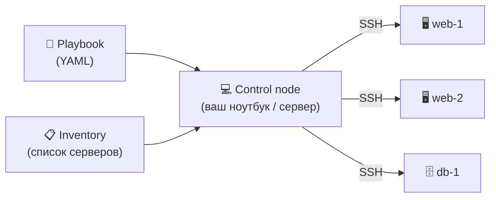

# ⚙️ Как это работает

### Три главных понятия

| Понятие | Что это |
|---|---|
| 📋 **Inventory** | Список серверов и групп, которыми управляем |
| 📜 **Playbook** | Сценарий: *на каких* серверах *какие* задачи выполнить |
| 🧱 **Module** | Готовый «кирпичик» действия: `apt`, `copy`, `service`, `user`… |

> [!TIP]
> Ansible подключается по SSH, выполняет модули на серверах и убирает за собой. Никаких постоянных агентов.

---

[⬅️ Назад](03-what-is-ansible.md) · [Далее ➡️](05-example-inventory.md)

●●●●○○○○ &nbsp; слайд 4 из 8

